# UML Class Diagram: Clinic Appointment Management System

This document visualizes the object-oriented structure, domain models, service architectures, and design patterns implemented across the system.

```mermaid
classDiagram
    direction TB

    %% ==========================================
    %% DOMAIN ENTITIES & MODELS
    %% ==========================================
    class User {
        +int id
        +string email
        +string full_name
        +string hashed_password
        +string role
        +bool is_active
        +datetime created_at
    }

    class Patient {
        +int id
        +string full_name
        +date date_of_birth
        +string gender
        +string phone
        +string address
        +string emergency_contact
        +string medical_history
        +string allergies
        +datetime created_at
    }

    class Doctor {
        +int id
        +int user_id
        +string specialization
        +float consultation_fee
        +string phone
        +bool is_available
    }

    class DoctorSchedule {
        +int id
        +int doctor_id
        +string day_of_week
        +string start_time
        +string end_time
        +int slot_duration_minutes
        +int max_patients
    }

    class Appointment {
        +int id
        +int patient_id
        +int doctor_id
        +date appointment_date
        +string appointment_time
        +string status
        +string reason
        +string cancellation_reason
        +datetime created_at
    }

    class Invoice {
        +int id
        +int appointment_id
        +int patient_id
        +float gross_amount
        +string discount_type
        +float discount_amount
        +float tax_amount
        +float net_total
        +string status
        +datetime created_at
    }

    class Payment {
        +int id
        +int invoice_id
        +string payment_method
        +float amount_paid
        +string transaction_ref
        +string status
        +datetime payment_date
    }

    %% Entity Relationships
    User "1" --> "0..1" Doctor : associates
    Doctor "1" *-- "0..*" DoctorSchedule : contains
    Patient "1" --> "0..*" Appointment : books
    Doctor "1" --> "0..*" Appointment : attends
    Appointment "1" --> "0..1" Invoice : generates
    Invoice "1" *-- "0..*" Payment : receives

    %% ==========================================
    %% REPOSITORY PATTERN (Structural)
    %% ==========================================
    class IRepository~T~ {
        <<interface>>
        +get_by_id(id: int) T
        +get_all() List~T~
        +create(entity: T) T
        +update(id: int, data: dict) T
        +delete(id: int) bool
    }

    class BaseRepository~T~ {
        #Session session
        #Type~T~ model_class
        +get_by_id(id: int) T
        +get_all() List~T~
        +create(entity: T) T
        +update(id: int, data: dict) T
        +delete(id: int) bool
    }

    class UserRepository {
        +get_by_email(email: string) User
    }
    class PatientRepository {
        +search(query: string) List~Patient~
    }
    class DoctorRepository {
        +get_by_user_id(user_id: int) Doctor
        +get_schedules(doctor_id: int) List~DoctorSchedule~
        +add_schedule(schedule: DoctorSchedule) DoctorSchedule
    }
    class AppointmentRepository {
        +check_doctor_conflict(doctor_id: int, date: date, time: string) bool
        +check_patient_conflict(patient_id: int, date: date, time: string) bool
        +get_by_date(date: date) List~Appointment~
        +get_by_doctor_and_date(doctor_id: int, date: date) List~Appointment~
    }
    class BillingRepository {
        +get_invoice_by_appointment(appointment_id: int) Invoice
        +get_invoices_by_date_range(start_date: date, end_date: date) List~Invoice~
        +record_payment(payment: Payment) Payment
    }

    IRepository <|.. BaseRepository : implements
    BaseRepository <|-- UserRepository
    BaseRepository <|-- PatientRepository
    BaseRepository <|-- DoctorRepository
    BaseRepository <|-- AppointmentRepository
    BaseRepository <|-- BillingRepository

    %% ==========================================
    %% STRATEGY PATTERN (Behavioral)
    %% ==========================================
    class IDiscountStrategy {
        <<interface>>
        +get_discount_name() string
        +get_discount_percentage() float
        +calculate_discount(gross_amount: float) float
    }

    class NoDiscountStrategy {
        +calculate_discount(gross_amount: float) float
    }
    class StudentDiscountStrategy {
        +calculate_discount(gross_amount: float) float
    }
    class SeniorCitizenDiscountStrategy {
        +calculate_discount(gross_amount: float) float
    }
    class InsuranceDiscountStrategy {
        +calculate_discount(gross_amount: float) float
    }

    class BillingCalculationEngine {
        -float TAX_RATE
        +calculate_bill(gross_amount: float, strategy: IDiscountStrategy) dict
    }

    IDiscountStrategy <|.. NoDiscountStrategy : implements
    IDiscountStrategy <|.. StudentDiscountStrategy : implements
    IDiscountStrategy <|.. SeniorCitizenDiscountStrategy : implements
    IDiscountStrategy <|.. InsuranceDiscountStrategy : implements
    BillingCalculationEngine ..> IDiscountStrategy : executes

    %% ==========================================
    %% FACTORY PATTERN (Creational)
    %% ==========================================
    class IPaymentProcessor {
        <<interface>>
        +process_payment(invoice: Invoice, amount: float, ref: string) dict
    }

    class CashPaymentProcessor {
        +process_payment(invoice: Invoice, amount: float, ref: string) dict
    }
    class CardPaymentProcessor {
        +process_payment(invoice: Invoice, amount: float, ref: string) dict
    }
    class MobileBankingPaymentProcessor {
        +process_payment(invoice: Invoice, amount: float, ref: string) dict
    }

    class PaymentProcessorFactory {
        +create_processor(method: string) IPaymentProcessor
    }

    IPaymentProcessor <|.. CashPaymentProcessor : implements
    IPaymentProcessor <|.. CardPaymentProcessor : implements
    IPaymentProcessor <|.. MobileBankingPaymentProcessor : implements
    PaymentProcessorFactory ..> IPaymentProcessor : instantiates

    class IReportGenerator {
        <<interface>>
        +generate(db_session: Session, params: dict) dict
    }

    class DailyAppointmentReportGenerator {
        +generate(db_session: Session, params: dict) dict
    }
    class RevenueReportGenerator {
        +generate(db_session: Session, params: dict) dict
    }

    class ReportGeneratorFactory {
        +create_generator(report_type: string) IReportGenerator
    }

    IReportGenerator <|.. DailyAppointmentReportGenerator : implements
    IReportGenerator <|.. RevenueReportGenerator : implements
    ReportGeneratorFactory ..> IReportGenerator : instantiates

    %% ==========================================
    %% BUSINESS SERVICE LAYER
    %% ==========================================
    class AuthService {
        -UserRepository user_repo
        +authenticate(email: string, pass: string) string
        +create_user(data: dict) User
    }

    class AppointmentService {
        -AppointmentRepository appt_repo
        -DoctorRepository doc_repo
        -PatientRepository pat_repo
        +book_appointment(data: dict) Appointment
        +cancel_appointment(id: int, reason: string) Appointment
    }

    class BillingService {
        -BillingRepository bill_repo
        -AppointmentRepository appt_repo
        -BillingCalculationEngine calc_engine
        +create_invoice(appt_id: int, discount_type: string) Invoice
        +process_payment(invoice_id: int, method: string, amount: float, ref: string) Payment
    }

    class ReportService {
        +generate_report(report_type: string, params: dict) dict
    }

    AuthService --> UserRepository : uses
    AppointmentService --> AppointmentRepository : uses
    BillingService --> BillingRepository : uses
    BillingService --> PaymentProcessorFactory : delegates
    BillingService --> BillingCalculationEngine : delegates
    ReportService --> ReportGeneratorFactory : delegates
```

